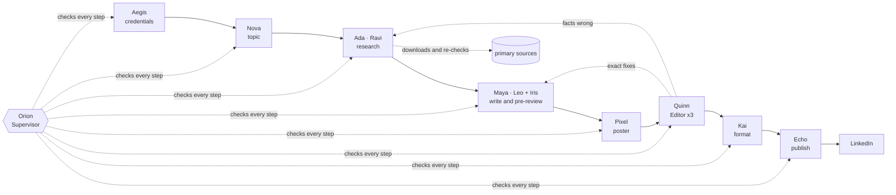

<p align="center">
  
</p>

<p align="center">
  <a href="https://github.com/sudip1205/social-postcrew/blob/main/LICENSE"></a>
  
  
  
</p>

<p align="center">
  <a href="https://github.com/sudip1205/social-postcrew/blob/main/docs/getting-started.md"><b>Getting started</b></a> ·
  <a href="https://github.com/sudip1205/social-postcrew/blob/main/docs/studio-guide.md">Studio guide</a> ·
  <a href="https://github.com/sudip1205/social-postcrew/blob/main/docs/configuration.md">Configuration</a> ·
  <a href="https://github.com/sudip1205/social-postcrew/blob/main/docs/agents.md">How the crew works</a> ·
  <a href="https://github.com/sudip1205/social-postcrew/blob/main/docs/troubleshooting.md">Troubleshooting</a>
</p>

## Try it in 60 seconds

```bash
pip install postcrew
postcrew demo
```

The Studio opens at http://localhost:8765 and the crew writes a post while you watch: Nova picks the topic,
Ada and Ravi verify the source, Quinn sends the first draft back, and the fixed post lands in the Queue. The demo
runs the real pipeline and its checks on scripted answers, so you need no AI account, no API key and no
LinkedIn login, and nothing leaves your computer. Then [set it up for real posts](#quick-start).

Postcrew writes one LinkedIn post a day for you, on your own computer. A crew of named AI agents picks the
topic, researches primary sources, drafts the post, designs the poster, reviews it strictly and publishes it
at the time you choose. You watch all of it live in the Studio, and nothing goes out that you didn't allow.

<p align="center"></p>

## Why Postcrew

- **A crew, not one prompt.** Eleven agents with one job each: Nova picks the topic, Ada and Ravi research,
  Maya and Leo write, Iris pre-reviews, Pixel designs, Quinn edits, Kai formats, Echo publishes, Aegis
  watches your credentials, Vega plans the week. Orion, the Supervisor, checks every step.
- **Accuracy you can audit.** Postcrew downloads every source page itself and rejects any quote that isn't on
  it. Every price, percent and big number must come from a verified source. Code on posters must parse.
- **Strict review that converges.** The writers and the Editor use the same scoring guide. The Editor scores
  each post three times and the worst score counts. A post that falls short comes back with at most four
  exact fixes, one per weak criterion, which the writer applies word for word.
- **It learns.** Problems fixed in approved runs become lessons for the next run. Team members whose work is
  consistently weak are replaced, and the team writes down what went wrong.
- **Visual by default.** 1080×1350 posters (points, steps, code, flow), or the same poster as an animated video
  that builds up piece by piece, for any topic. Algorithm posts get an MP4 where the line of Java being executed
  lights up as the data moves.
- **You stay in control.** Practice mode is on until you turn it off. Publish automatically with a veto
  window, wait for your approval, or publish right away.
- **Private and local.** No server, no database, no telemetry. Your settings, secrets and posts stay in one
  folder on your machine.
- **Bring your own AI.** Use your Claude Pro / Max / Team plan through [Claude Code](https://claude.com/claude-code)
  (no API key), the Claude API, the OpenAI API, or any OpenAI-compatible server: Ollama, LM Studio,
  OpenRouter, Groq, vLLM. [AI providers →](https://github.com/sudip1205/social-postcrew/blob/main/docs/ai-providers.md)
- **Alerts worth reading.** Styled emails with the post, its poster and a table of the details, plus
  desktop and Telegram alerts.
- **Official LinkedIn API only.** OAuth from the Studio. It posts to your profile and adds the first comment,
  and nothing else.

## How a post is made

<p align="center"></p>



When any step fails, the reasons travel with the work: the agent sees who sent it back, why, everything it
was sent back for earlier in the run, and what to change. [More about the crew →](https://github.com/sudip1205/social-postcrew/blob/main/docs/agents.md)

## Quick start

You need Python 3.9+ on macOS, Linux or Windows with WSL, and an AI provider: by default
[Claude Code](https://claude.com/claude-code) logged in to your Claude plan (`claude`, once), or an Anthropic or
OpenAI API key, or a local model such as Ollama ([AI providers](https://github.com/sudip1205/social-postcrew/blob/main/docs/ai-providers.md)).

```bash
pip install postcrew
postcrew init        # creates your workspace (~/.postcrew) with default settings
postcrew doctor      # checks what is installed and configured
postcrew serve       # opens the Studio at http://localhost:8765 and starts the scheduler
```

Or from source, if you want to change the code (the workspace is then `./workspace` in the project folder):

```bash
git clone https://github.com/sudip1205/social-postcrew.git postcrew && cd postcrew
python3 -m venv .venv && source .venv/bin/activate
python3 -m pip install --upgrade pip -e .
postcrew init && postcrew serve
```

Then, in the Studio:

1. **Settings**: your topics and ideas, which topic goes on which day, and true facts about you (the writers
   never invent experience).
2. **Overview → Run the crew now**, with **Rehearsal** ticked. Watch it in **Workflow**. Nothing is queued.
3. **Credentials**: create a free LinkedIn developer app ([5-minute guide](https://github.com/sudip1205/social-postcrew/blob/main/docs/linkedin-setup.md)) and click
   **Connect LinkedIn**.
4. When you like the results, turn off **Practice mode** in Settings.

The full walkthrough is in [Getting started](https://github.com/sudip1205/social-postcrew/blob/main/docs/getting-started.md).

## The Studio

| | |
|---|---|
|  **Overview**: what's next, warnings, run the crew now, recent runs |  **Queue**: LinkedIn-style previews; approve, edit, veto or publish now |
|  **Crew**: every agent by team, the roster, lessons and long-term memory |  **Plan**: this week's topics; edit any day or ask for another |
|  **Settings**: topics, schedule, about you, models and limits |  **Credentials**: LinkedIn, Claude Code, Gmail, Telegram |

Every tab, panel and button is explained in the [Studio guide](https://github.com/sudip1205/social-postcrew/blob/main/docs/studio-guide.md).

## Documentation

| | |
|---|---|
| [Getting started](https://github.com/sudip1205/social-postcrew/blob/main/docs/getting-started.md) | install, first rehearsal, go live, update, uninstall |
| [AI providers](https://github.com/sudip1205/social-postcrew/blob/main/docs/ai-providers.md) | Claude plan, Claude API, OpenAI API, Ollama and other OpenAI-compatible servers |
| [Connect LinkedIn](https://github.com/sudip1205/social-postcrew/blob/main/docs/linkedin-setup.md) | the developer app, OAuth, token expiry, the first comment |
| [Studio guide](https://github.com/sudip1205/social-postcrew/blob/main/docs/studio-guide.md) | every tab and button |
| [Configuration reference](https://github.com/sudip1205/social-postcrew/blob/main/docs/configuration.md) | every setting in `config.json`, categories, secrets, the workspace folder, prompts |
| [The crew](https://github.com/sudip1205/social-postcrew/blob/main/docs/agents.md) | each agent, the review loop, memory, the roster |
| [Notifications](https://github.com/sudip1205/social-postcrew/blob/main/docs/notifications.md) | desktop, Gmail, Telegram |
| [Running unattended](https://github.com/sudip1205/social-postcrew/blob/main/docs/running-unattended.md) | launchd, systemd, cron, on a server |
| [Troubleshooting and FAQ](https://github.com/sudip1205/social-postcrew/blob/main/docs/troubleshooting.md) | when something doesn't work |
| [Extending](https://github.com/sudip1205/social-postcrew/blob/main/docs/extending.md) | code map, new agents, animations, model backends |

## Command line

```
postcrew demo [--port 8765]              # a full run on scripted answers, in its own demo workspace
postcrew init | serve | doctor | check | status
postcrew serve [--port 8765] [--no-scheduler]
postcrew run [--date YYYY-MM-DD] [--category ai-news] [--dry-run]
postcrew publish                         # publish whatever is due
postcrew plan                            # draft the rest of this week's topics now
postcrew import posts.json               # posts published elsewhere, never repeated
```

`python3 -m postcrew ...` works the same way.

To use another workspace folder, put `--workspace PATH` before the command, or set `POSTCREW_HOME`.

## Your data stays yours

Everything that is yours lives in one folder, the workspace (`~/.postcrew`, or `./workspace` in a source
checkout, which git ignores):

- `config.json` holds your settings.
- `secrets.json` holds your LinkedIn, Gmail and Telegram secrets. It is readable only by your user, and the
  Studio never sends them back to the browser.
- The folder also holds the queue, the published list, run logs and memory.

The Studio only listens on `127.0.0.1`. Agents have no shell and no code tools: through Claude Code they run in
an isolated mode (no MCP servers, your own Claude settings ignored), and through an API they can only answer
and, where the provider offers it, search the web. Web pages are treated as
data, never as instructions. See [SECURITY.md](https://github.com/sudip1205/social-postcrew/blob/main/SECURITY.md).

## Costs

Postcrew is free. LinkedIn's API is free. The AI runs on your own account: on a Claude Pro or Max plan, posts
count towards your plan's usage limits; with an API key, you pay your provider per use; a local model is free. Every run shows
its cost at API prices, and you can cap it per call and per post in Settings. With the default models, a
researched news post typically uses $1-2 at API prices, and a short dev tip far less.

## Responsible use

Postcrew posts only to your own profile, through LinkedIn's official API. It doesn't comment on other
posts, message, connect, like or scrape. It never invents personal experience: the writers may only use the
facts you list about yourself. You are responsible for what is published under your name, so keep practice
mode or manual approval on until you trust the output.

LinkedIn is a trademark of LinkedIn Corporation. Claude is a trademark of Anthropic. This project is not
affiliated with or endorsed by LinkedIn or Anthropic.

## Contributing

Issues and pull requests are welcome. See [CONTRIBUTING.md](https://github.com/sudip1205/social-postcrew/blob/main/CONTRIBUTING.md) and [Extending](https://github.com/sudip1205/social-postcrew/blob/main/docs/extending.md).
The tests run offline in about 20 seconds: `python3 -m unittest discover -s tests`.

## License

[MIT](https://github.com/sudip1205/social-postcrew/blob/main/LICENSE)
