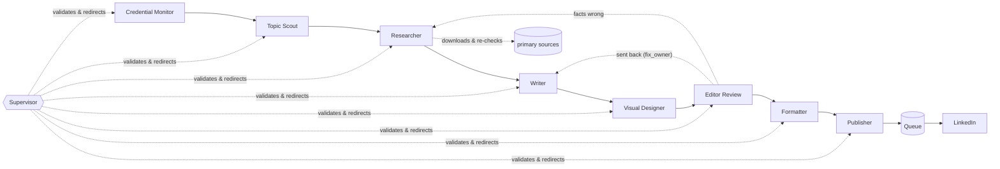

# Postcrew

A crew of AI agents that writes, fact-checks, designs, reviews and publishes one LinkedIn post a day for you,
with a live dashboard that shows every step.

- **Multi-agent, supervised.** A Topic Scout, Researcher, Writer, Visual Designer, Editor Review, Formatter
  and Publisher each do one job. A Supervisor validates every output and, when an agent gets stuck, tells it
  exactly what to fix or sends the work back to the agent that caused the problem.
- **Accuracy you can audit.** The Researcher's quotes are checked against pages the program downloads
  itself. Every price, percent and big number in the post must appear in a verified source. Code on posters
  must parse. Nothing reaches the queue without passing a strict review, scored 3 times with the worst score
  kept.
- **Visual by default.** 1080×1350 posters (points, steps, code, flow) and, for algorithm posts, an MP4
  where the line of Java being executed is highlighted as the data moves.
- **Everything is logged and visualized.** Each run has a full event log, every agent's output, and a live
  workflow graph in the Studio.
- **No API keys for the AI.** Every agent runs through your [Claude Code](https://claude.com/claude-code)
  login (`claude -p`), isolated from your own Claude settings, with only the tools it needs and a dollar cap
  per call and per post.
- **Official LinkedIn API only.** OAuth sign-in from the Studio; a Credential Monitor checks the token daily
  and tells you before it expires.
- Standard-library Python plus Pillow. No database, no build step, no cloud service.

## How a post is made



| Agent | Does | Validated by |
|---|---|---|
| Credential Monitor | LinkedIn token valid and not expiring? Claude Code logged in? | free API check, `claude auth status` |
| Topic Scout | picks the topic for the day's category, never a repeat | length, similarity to the last 60 posts |
| Researcher | chooses primary sources with WebSearch, the program downloads them, then quotes them verbatim | every quote must be on the downloaded page; every fact needs a quote; recency |
| Writer | writes the post from verified facts only, in your voice | length, hook, no markdown, no hype words, no placeholders, no invented experience, unsourced numbers, stray links |
| Visual Designer | poster spec (rendered with Pillow) or algorithm animation (ffmpeg) | it renders and fits, layout allowed, code parses, numbers sourced |
| Editor Review | scores accuracy, clarity, hook, value, tone, format; flags real problems | worst of 3 reviews must reach your thresholds with no red flag |
| Formatter | LinkedIn formatting: hook above "...see more", links to the first comment, hashtags last | 3,000-character limit, fold length |
| Publisher | queues for post time (or your approval) and posts with native image/video | credentials re-checked right before posting |

When a step fails, the Supervisor reads the problems and the outputs so far and decides: **retry** with
specific instructions, **rewind** to an earlier agent (for example: the Editor found an unsupported claim →
the Writer revises its previous draft), or **abort**. Hard limits on tries and dollars always apply, and a
failed day notifies you with the reason.

## Quick start

Requirements: Python 3.9+, [Claude Code](https://claude.com/claude-code) installed and logged in, and
ffmpeg for algorithm videos (optional).

```bash
git clone https://github.com/<you>/postcrew && cd postcrew
python3 -m pip install -r requirements.txt
python3 -m postcrew init
python3 -m postcrew doctor      # checks what is installed and configured
python3 -m postcrew serve       # opens the Studio at http://localhost:8765 and starts the scheduler
```

Then, in the Studio:

1. **Settings**: your name, the handle printed on posters, your audience, true facts about yourself (the
   writer never invents experience), what to post each day, models per agent, approval mode.
2. **Credentials**: create a free LinkedIn developer app (the page walks you through it), paste its Client
   ID and Secret, click **Connect LinkedIn**.
3. **Overview → Run the crew now** with *Rehearsal* ticked: every agent runs, nothing is queued. Open the
   **Workflow** tab to watch it.
4. When you like the results, untick **Dry run** in Settings → Publishing.

Publishing starts in dry-run mode: the publisher logs exactly what it would send and sends nothing until
you turn that off.

## The Studio

| Tab | What you can do |
|---|---|
| Overview | next post and run, LinkedIn status, start a run or rehearsal, pause the schedule, recent runs |
| Workflow | live graph of the crew (state, tries, cost per agent, sent-back arrows), the Supervisor's decisions, each agent's output and rendered media, the full event log |
| Queue | LinkedIn-style preview of every queued post: approve, edit, veto, publish now; the published history |
| Settings | the configurator: profile, schedule and days, categories and their briefs, models and limits per agent, quality thresholds, notifications |
| Credentials | LinkedIn app and OAuth connect/reconnect, token status, Claude Code login test, Telegram |

Notifications (bell icon) appear in the Studio and, if enabled, as desktop notifications and Telegram
messages: token expiring or invalid, a day with no post and why, a post ready or published, failures.

## Configuration

Everything lives in one workspace folder (`./workspace`, or set `POSTCREW_HOME`):

```
workspace/
  config.json     settings from the Studio (no secrets)
  secrets.json    LinkedIn app + token, Telegram (mode 600, never commit it)
  queue.json      posts that passed review
  history.json    what was published (used to avoid repeats)
  media/          queued posters and videos
  runs/<run_id>/  events.jsonl, status.json, each agent's output, rejected attempts, media
  prompts/        optional: your own version of any file in postcrew/prompts/
  PAUSE           create this file to stop all generating and publishing
```

**Approval modes:** `auto_with_veto` (default; posts at post time unless you veto), `manual` (waits for
Approve), `immediate`.

**Categories** are fully configurable: label, media (`poster`, `animation`, `none`), poster layouts,
research (`required`, `optional`, `off`), length, whether every number must be sourced, maximum source age,
and the brief that tells the agents what the post must contain. Seven are built in: algorithm, ai-news,
build-guide, tool-spotlight, security, dev-tip, week-recap.

**Prompts** for every agent are plain Markdown in `postcrew/prompts/`. Copy one into `workspace/prompts/`
to change it without touching the code.

## Running it unattended

`postcrew serve` includes the scheduler: it writes the post at `generate_time` the day before, publishes at
`post_time`, and checks credentials daily. Keep it running as a service:

- **macOS:** `deploy/launchd/com.postcrew.studio.plist` (instructions inside)
- **Linux:** `deploy/systemd/postcrew.service` (a user service; instructions inside)
- **cron instead:** run `postcrew serve --no-scheduler` for the Studio and schedule
  `python3 -m postcrew run`, `python3 -m postcrew publish` and `python3 -m postcrew check` yourself.

The Studio listens on `127.0.0.1` only. On a remote machine, reach it with an SSH tunnel
(`ssh -L 8765:localhost:8765 your-server`); LinkedIn's OAuth redirect then still works on `localhost`.

## Command line

```
python3 -m postcrew init | serve | doctor | check | status
python3 -m postcrew run [--date YYYY-MM-DD] [--category ai-news] [--dry-run]
python3 -m postcrew publish
```

## Costs

You pay only for Claude usage on your own account (each call reports its cost; per-call and per-post caps
are in Settings). In testing, a short dev tip cost about $0.03 and a researched news post with two revisions
about $0.70, using Sonnet for writing and Haiku for review. LinkedIn's API is free.

## Adding an algorithm animation

Algorithm posts use built-in, tested traces (`postcrew/render/tracers.py`): Java code plus a step-by-step
trace of what it does. The tests compile and run the Java and compare it with the animation, so the code on
screen is real. To add one, add a `Tracer` and run the tests.

## Extending

- **Another LLM backend:** implement `call(agent_id, system, prompt, schema, tools, cwd)` returning an
  `LLMResult` and register it in `postcrew/llm.py`.
- **Another agent:** subclass `Agent` (`run` + `validate`), add it to `CREW` in
  `postcrew/agents/supervisor.py` and to `STEPS` in `postcrew/runlog.py`.

## Development

```bash
python3 -m unittest discover -s tests     # no network, no tokens: the LLM, web and LinkedIn are faked
```

See [CONTRIBUTING.md](CONTRIBUTING.md). Security reports: [SECURITY.md](SECURITY.md).

## Responsible use

Postcrew publishes only to your own profile through LinkedIn's official API. It does not comment, message,
connect, like or scrape. It never invents personal experience: the writer may only use facts you list in
Settings. You are responsible for what is published under your name; keep dry run or `manual` approval on
until you trust the output.

LinkedIn is a trademark of LinkedIn Corporation. This project is not affiliated with or endorsed by LinkedIn
or Anthropic.

## License

[MIT](LICENSE)
