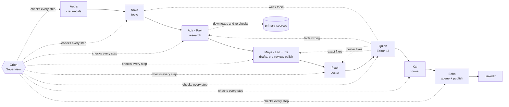

# The crew: how a post is made

Postcrew is a team of small agents. Each one does one job, its output is checked by plain code before anything
else sees it, and a Supervisor decides what happens when something fails. This page explains who does what,
how the review works, and how the crew remembers and learns.

## Who does what

Every agent has a name, a team colour and an icon in the Studio, so you can tell at a glance who is working.

| Team | Agent | Job | Checked by code before it is accepted |
|---|---|---|---|
| Command | **Orion**, Supervisor | Watches every step. When one fails, decides to retry it with specific instructions, rewind to an earlier agent, or stop. | its decision must name a real step; hard limits on tries and cost always apply |
| Planning | **Vega**, Week Planner | Drafts a topic for every open day of the week, using your ideas first. | no repeats of published, planned or rejected topics |
| Planning | **Nova**, Topic Scout | Picks the day's topic for its category, or takes the planned one. Prefers things readers can use now over "coming soon" announcements. | length, similarity to the last 60 posts |
| Research team | **Ada · Ravi** (by default) | Each chooses primary sources with web search. Postcrew downloads the pages itself, and each researcher quotes them word for word. Their verified work is combined. | every quote must be on the downloaded page; every fact needs a quote; sources must be recent enough |
| Writing team | **Maya · Leo** (by default) | Each writes a full draft from verified facts only, in your voice and their own style. | length, hook, no markdown, no hype words, no placeholders, no invented experience, no unsourced numbers, no stray links, no blocked phrases |
| Writing team | **Iris**, Pre-reviewer | Scores every draft the way the Editor will, picks the best and polishes it. | |
| Design | **Pixel**, Visual Designer | Writes the poster spec (rendered with Pillow) or picks the algorithm animation (rendered with ffmpeg). | it renders and fits; allowed layout; code on posters parses; numbers are sourced; poster text matches the post |
| Quality | **Quinn**, Editor Review | Scores accuracy, clarity, hook, value, tone and format, three times; the worst counts. Flags real problems. | overall ≥ 80, every criterion ≥ 70, no red flag (your thresholds) |
| Quality | **Kai**, Formatter | LinkedIn formatting: hook above "...see more", links moved to the first comment, hashtags last. No AI. | 3,000-character limit, fold length |
| Operations | **Aegis**, Credential Monitor | Checks the LinkedIn token and the Claude Code login before any work starts, and daily. No AI. | |
| Operations | **Echo**, Publisher | Queues the approved post for its date (or your approval), publishes it with its image or video, and adds the first comment. No AI. | credentials re-checked right before posting |

## One run, step by step

1. **Aegis** checks that LinkedIn and Claude Code are ready. A run never starts on broken credentials.
2. **Nova** picks the topic: the one in the Plan, otherwise an unused idea from your list, otherwise a new
   one for the category.
3. **The research team** (when the category needs it) searches, Postcrew downloads the pages, and each
   researcher quotes them. Any quote that is not on the page is rejected. If no fresh source exists, the
   work goes back to Nova for a better topic instead of retrying research forever.
4. **The writers** each draft the post; code checks each draft. **Iris** scores the drafts with the Editor's
   rubric and picks the best. If it isn't comfortably above the bar, she gives exact fixes and the writer
   applies them, up to `polish_rounds` times.
5. **Pixel** designs the poster, which is rendered and checked.
6. **Quinn** reviews the whole post three times independently. The worst score counts.
7. **Kai** formats it for LinkedIn, and **Echo** queues it (or publishes it, in `immediate` mode).

Every agent's output, every rejected attempt and every decision is saved in `workspace/runs/<run_id>/`
and shown live in the Workflow tab.

## When a step fails

The reasons always travel with the work. When Orion sends something back, the agent sees:

- **who** sent it back, and **why**, in specific terms ("the quote '...' is not on the page", "hook scored 66
  (needs 70)");
- **every earlier reason** its work was sent back for in this run, so a revision does not bring back a mistake
  that was already fixed;
- **the instructions** for this try.

Orion chooses between **retry** (same agent, with instructions), **rewind** (an earlier agent must redo its
work, e.g. a claim is unsupported, so research goes again) and **abort** (when nothing would fix it). Limits
from `pipeline` always apply.

### How the Editor's review works

The writers, Iris and Quinn all use the same scoring guide ([`rubric.md`](../postcrew/prompts/rubric.md)),
which says what each score means. For example, a hook scores 90+ only if it is at most 120 characters, leads
with one concrete sourced fact and makes the reader's stake obvious.

When a post falls short:

- Quinn gives **at most four fixes, one per failing criterion**, lowest score first, each as an exact edit
  ("Replace line 1 with: '...'"). Fixes may only use facts from the sources, and prefer cutting to adding.
- From Quinn's three reviews, Postcrew keeps the fix for each failing criterion from the review that scored
  it lowest, so the fixes don't contradict each other.
- The fixes go **straight to their owner, word for word**: the writer for text, Pixel for the poster,
  research for wrong facts, Nova for a weak topic. Nobody rewrites them on the way.
- The writer applies those fixes and changes nothing else.
- On the next round, Quinn sees what it asked for before, so it checks those fixes instead of moving the
  goalposts.

The passing bar is yours (`min_overall`, `min_subscore`). Postcrew never lowers it to get a post through: a
day with no post is better than a weak post under your name.

## Memory

**Working memory** (one run, `runs/<run_id>/memory.json`) keeps every sending-back with its reasons and
instructions while the run is going. The Workflow tab shows it under **Working memory**.

**Long-term memory** (`state/memory.json`) is written only when a run's post passes the Editor. Every
problem that was fixed in that run is kept with the instructions that fixed it, at most 10 per step. Next
time, each agent starts with the three most recent lessons for its step, so it avoids the mistake on the
first try. See them on the **Crew** tab, and click **Forget** on any lesson that is wrong or out of date.

Runs that fail teach nothing, so a bad run can't plant bad advice.

## The roster: hiring and replacing

The research and writing teams have members with their own working style; Ada and Ravi, Maya and Leo are
the founding members. More are waiting to be hired (researchers Mei, Omar and Lena; writers Nora, Sam and Ivy).

After every run, each member's work is recorded:

- a **researcher** did good work when their sources were verified and every fact they gave had a quote;
- a **writer** did good work when their draft passed the checks and the pre-review (and the Editor, when
  theirs was chosen) scored it at the passing bar with no red flag.

A member with fewer than `fire_min_success` good posts out of their last `fire_window` is **replaced**. The
team writes down what went wrong as short lessons, and the new hire, and every colleague in that role, follow
them from then on. You get a notification when it happens.

On the **Crew** tab you can see each member's recent results and who is at risk, **Replace** a member or
**Hire another** yourself, and remove lessons you disagree with.

## Hard rules no agent can break

- No fact without a source quote when research is required, and every number checked when `fact_check` is on.
- No invented personal experience: only facts from **About you**.
- No blocked phrases (`profile.blocklist`).
- No placeholders, hype words, markdown or links in the body.
- Web pages are treated as data, never as instructions, in every prompt.
- Agents run with no shell, no code tools, no MCP servers and no access to your Claude settings; the
  researchers get web search and nothing else.
