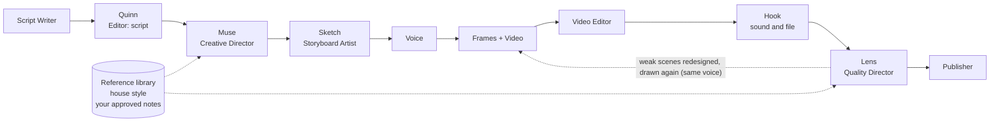

# Motion Studio: better-looking videos

Motion Studio adds two agents to the YouTube crew and a reference library they learn from. The goal is that every Short looks
directed and is checked by someone who actually watched it, instead of being assembled from slides and approved on its script alone.



## The two agents

**Muse, the Creative Director** (step `direction`) runs after the Editor approves the script and before anything is drawn or voiced.
For every scene it decides what the scene is for (hook, setup, explanation, example, reveal, summary), the one concrete picture that shows
the idea, the one thing the viewer must look at, and the beats that appear in the order the voice names them. It also states the
"concept": the picture that grows through the whole video. A program first finds what it can see for free: a long scene with nothing new to
show, the same layout three times in a row, too many words-only scenes, a hook that is only a title. The Storyboard Artist draws to the
Director's notes. It runs on Remotion videos (the renderer that reads the notes). If its model is unavailable, the run goes on without notes.

**Lens, the Quality Director** (step `quality`) runs after Quality Hooks, on the finished video. It grabs two frames of every scene (at
40% and 92% of its length) and:

1. measures them, free and without AI: an empty screen, a picture that fills only a sliver of the screen, a picture that does not change
   for many seconds;
2. shows contact sheets of the frames to a vision model together with the narration, the Director's plan, the house style and your
   approved preferences. The model scores readability on a phone, screen use, clarity, motion, variety and style, and gives the complete
   replacement picture for each weak scene (never the narration).

Under the pass mark (`video.motion.min_score`, 75) or with an empty scene, the replacements go through the same rule check as the
Storyboard Artist's changes, and the Supervisor draws the video again from the frame steps. The voice is reused, so a redraw costs only
rendering time. That happens at most `max_redraws` times (1). A video still under `hold_below` (60), or with an empty scene left,
**waits for your approval** whatever your approval setting. Its score and notes are on the run in Workflow and in the queued post
(`youtube.picture`).

A typical check costs about $0.08 at API prices (one Sonnet call with three contact sheets); a redraw adds one more.

## The reference library: the Style page

The crew learns *how* good explainers look, move and are written from videos you are allowed to use, never *what* they say. Profiles and
patterns are abstract ("a big number counts up, then a short label explains it", "state the common belief, then show it failing"). A
reference's words, frames, voice, music and branding are never reused.

Open **Style** in the Studio:

1. **Add a reference**: upload a video file, or paste its URL (fetched with [yt-dlp](https://github.com/yt-dlp/yt-dlp) on the computer
   running Postcrew). Say what right you have to use it: you made it, licensed it, have the creator's permission, or it is public domain.
   A public video is not yours to download: YouTube's terms forbid downloading other people's videos without permission. For those, analyse
   only the script and paste the transcript yourself: nothing is downloaded.
2. **Choose what to analyse**:
   - **Screens**: frames of every shot are measured (cuts, seconds per shot, screen use, colours) and a vision model describes the layout,
     type, motion, how each scene is built and the reusable scene patterns. Needs the video.
   - **Script**: the narration is studied for its hook, the order and length of its parts, its sentences, how it addresses the viewer, its
     devices and its ending, as rules a writer can follow and abstract script patterns. Needs the words: pasted, the video's subtitles (a URL),
     or local transcription with faster-whisper (an upload).
   You can analyse the other part later with **Analyse screens** / **Analyse script** on the reference.
3. **Review** "What the crew learned", then **Approve** the ones worth learning from (or Reject).
4. **Build from approved videos**: a new house-style version. The screens shape the Creative Director's plans and the Quality Director's
   judgement; the script style goes into the Script Writer's instructions (within your required parts: problem, ways, pictures first, code,
   mistake, closing, which always win). Versions are kept: switch back with the version buttons or **Back to built-in**.

Analyses run one at a time in the background; the page shows each one's progress. A Studio restart stops a running analysis (the reference
is marked failed with the reason; analyse it again), and the automatic deploy waits while one is running.

Optional extras, on the computer running Postcrew: `pip install "postcrew[motion]"` (or `pip install yt-dlp faster-whisper` in its
environment) for URLs and local transcription.

The same from the command line:

```bash
# 1. add a video you made, licensed or have permission for (a Short or one explainer, at most 10 minutes)
postcrew motion add ~/Videos/best-short.mp4 --rights own --analyze screen,script --notes "love the pacing and the big numbers"
postcrew motion add https://www.youtube.com/shorts/... --rights own --analyze script     # subtitles only, no video
postcrew motion add https://... --rights permission --analyze script --transcript narration.txt
postcrew motion analyze 20261103-a1b2c3 --analyze screen                                # the other part, later

postcrew motion list                 # status of every reference and the current house style
postcrew motion show 20261103-a1b2c3 # the full analysis: scenes, profile, patterns, strengths, weaknesses

# 2. approve the ones worth learning from (or reject them)
postcrew motion approve 20261103-a1b2c3

# 3. merge the approved references into a new house style version
postcrew motion style --build
postcrew motion style                # read it; --use 1 goes back to version 1, --reset to the built-in style
```

5 to 10 references in the style you want is a good start. The built-in house style applies until you build one, and its quality floor
(text at least 40 px, no empty or half-empty screens, no long stills, no walls of text) always stays in a built style.


## Checking any video

```bash
postcrew motion check 2026-11-03-110927        # a run id: uses the run's own scene timings
postcrew motion check ~/Videos/some-short.mp4  # any file: scenes from its cuts
postcrew motion check 2026-11-03-110927 --no-ai   # the free measurements only
```

It prints the findings, the vision verdict per scene and the score, and leaves the contact sheets in the run's `quality/` folder.

## Teaching it what you like

Feedback changes nothing until you approve it, so one bad day does not change the style.

```bash
postcrew motion feedback 2026-11-03-110927 --kind text_too_small --scene 7 --rating 2
postcrew motion feedback --list
postcrew motion feedback --approve 3f9a1c2e                       # the built-in rule for that kind
postcrew motion feedback --approve 3f9a1c2e --rule "Call-tree nodes show at most 7 calls, big"
postcrew motion prefs                                             # what the crew follows now; --forget N removes one
```

Kinds: `hook_weak`, `narration_fast`, `too_much_text`, `too_few_changes`, `animation_slow`, `animation_busy`, `wrong_palette`,
`poor_metaphor`, `wrong_fact`, `captions_hard`, `audio_mismatch`, `transition_awkward`, `text_too_small`, `empty_screen`, `other`.
Approved preferences go into both Directors' instructions on every run.

## Settings

In `config.json`, under `platforms.youtube.video.motion`:

| key | default | |
|---|---|---|
| `director` | `true` | run the Creative Director |
| `quality` | `true` | run the Quality Director |
| `min_score` | `75` | under this the weak scenes are redesigned and drawn again |
| `max_redraws` | `1` | redraws per run (0-3) |
| `hold_below` | `60` | a video still under this waits for your approval |

Models: `llm.agents.direction`, `llm.agents.quality` and `llm.agents.motion` (reference analysis), Sonnet by default. The vision review
needs a model that reads images: Claude through Claude Code or the API, an OpenAI vision model, or a vision model on an OpenAI-compatible
server. Without one, the Quality Director judges on its measurements alone.

## Files

Everything is in the workspace, in `motion/`: `references/<id>/` (the video copy, frames, contact sheets, `analysis.json`),
`styles/house-v<N>.json`, `feedback.jsonl` and `preferences.json`. `postcrew motion delete ID` removes a reference and its files.
