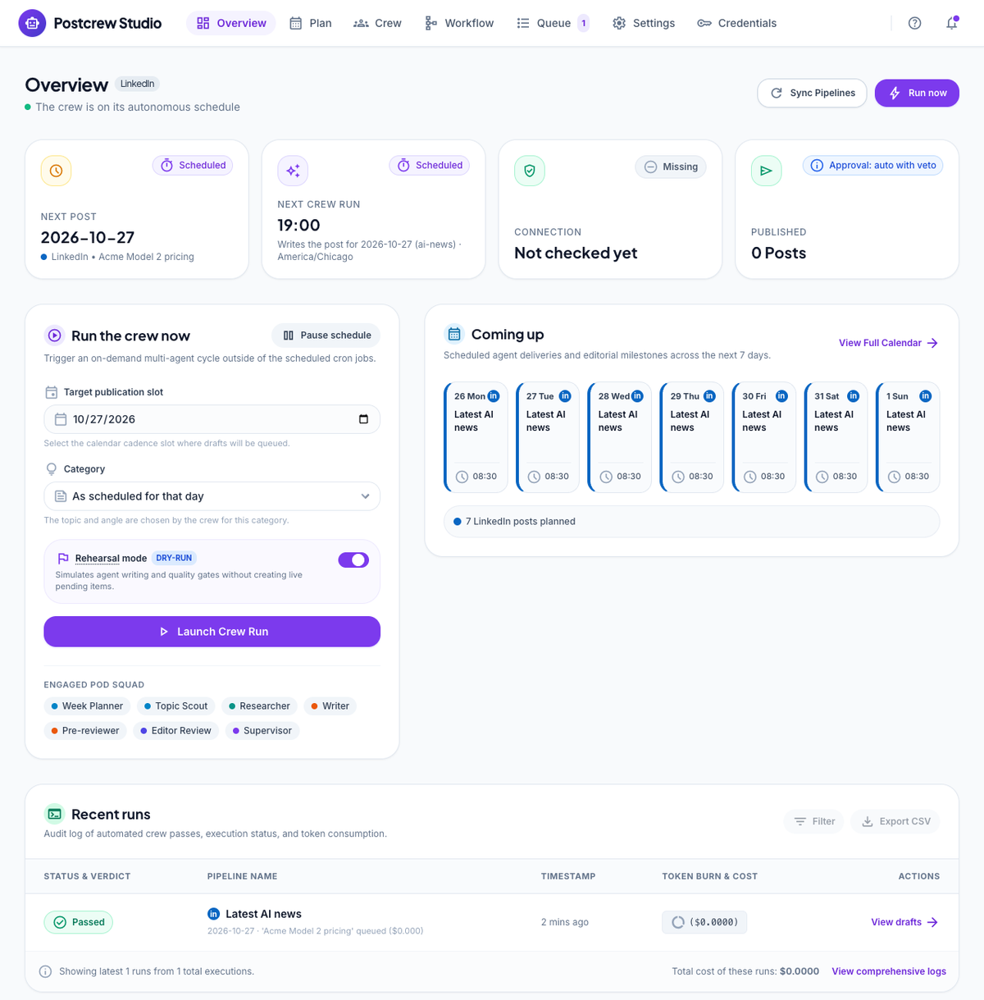
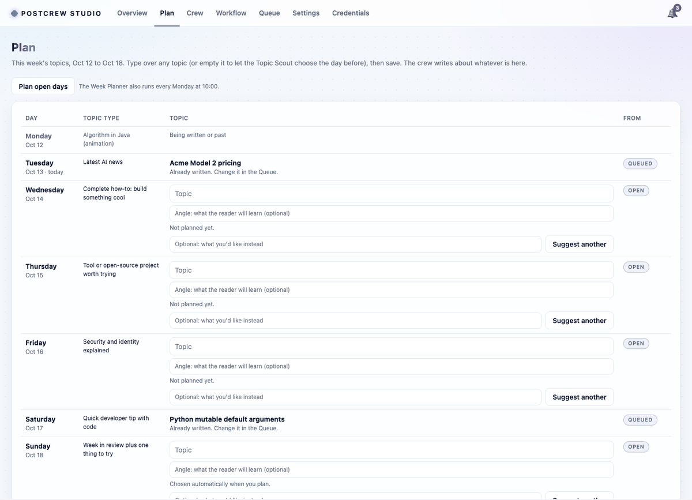
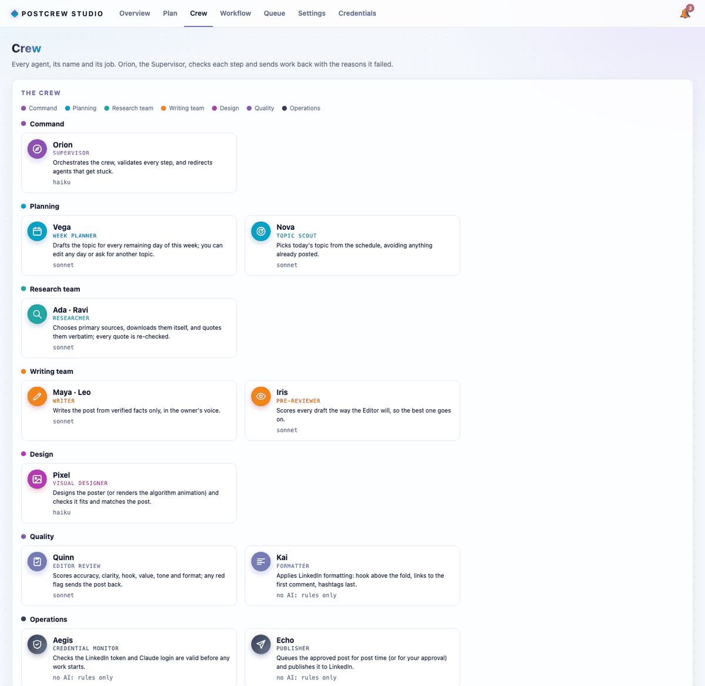
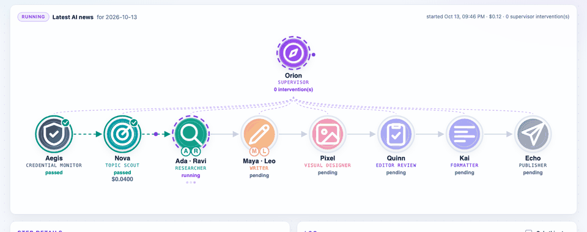
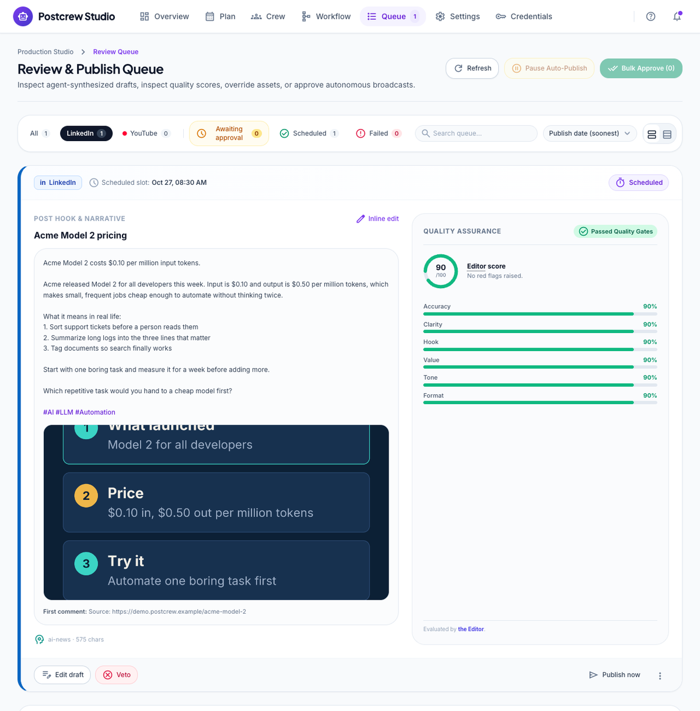
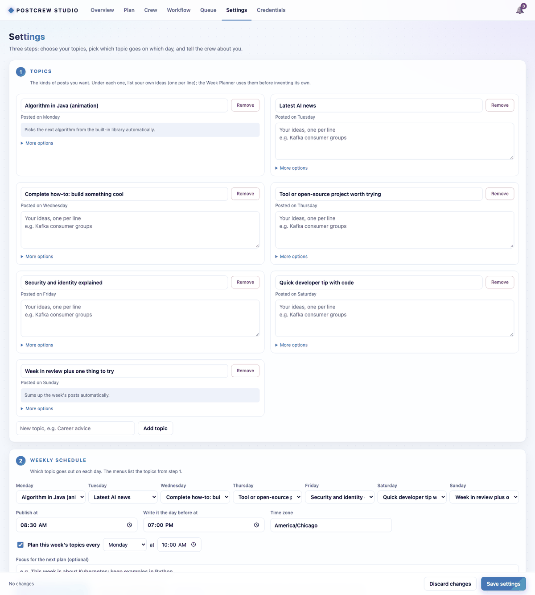
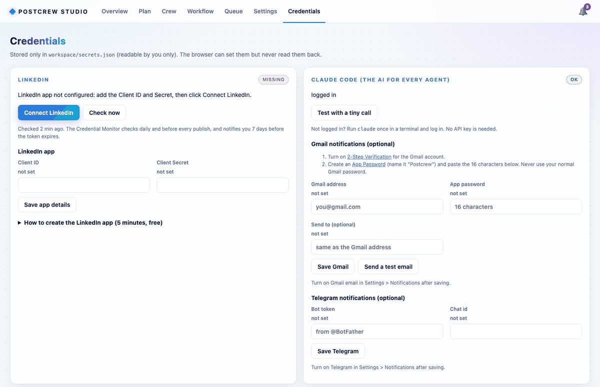

# Studio guide

The Studio is Postcrew's dashboard at **http://localhost:8765**. It opens when you run
`python3 -m postcrew serve`. It has seven tabs and a notification bell; this page walks through each one.

[Overview](#overview) · [Plan](#plan) · [Crew](#crew) · [Workflow](#workflow) · [Queue](#queue) ·
[Settings](#settings) · [Credentials](#credentials) · [Notifications](#notifications-the-bell)

> The screenshots use a demo workspace with made-up posts.

---

## Overview

Your home page.

- **Banners** at the top tell you what needs attention: LinkedIn not connected or expiring, practice mode
  on, the schedule paused. Each has a button that takes you to the fix.
- **Next post**: the next queued post, its date and status.
- **Next crew run**: when the scheduler writes the next post, for which date and category.
- **LinkedIn**: the token's state: `ok`, `expiring` (still works; reconnect soon), `expired`, `invalid`
  (revoked), `missing` (not connected) or `unreachable` (LinkedIn could not be reached).
- **Published**: how many posts are in your published list, and the approval mode.
- **Run the crew now**: write a post right away for any date and category.
  - **Post date**: the date the post is for. Its category comes from the schedule unless you pick one.
  - **Rehearsal**: run every agent but don't queue the result. Use this to try settings, prompts or
    categories; nothing can be published from a rehearsal.
  - Untick Rehearsal to make a real post for that date. If you do this for tomorrow, the scheduler sees the
    post and skips its own run.
- **Pause schedule**: stops all automatic writing and publishing until you resume (same as creating the
  `workspace/PAUSE` file). Manual runs still work.
- **Recent runs**: every run with its state, result, cost and number of Supervisor interventions. Click one
  to open it in Workflow.

## Plan

This week, Monday to Sunday.

- Each open day shows the **topic** and an optional **angle** (what the reader will learn). Type over any of
  them; leave a day empty to let the Topic Scout choose the evening before.
- **Suggest another** asks the Week Planner for a different topic for that day. Type a hint first ("something
  about Postgres") if you have one.
- **Plan open days** fills every empty day now. Days you typed are never changed.
- **Save plan** saves all your edits together; **Discard changes** throws them away.
- Days that are already written show their status, such as **queued** (change those in the Queue).
- The **From** column shows each day's state: who planned it (the planner or you), **open** if nobody has
  yet, or the status of a post already written.

The planner runs by itself every week (Settings > Weekly schedule) and always uses your own topic ideas
before inventing new ones.

## Crew

Everyone in the crew, grouped by team, with their name, role, what they do and which model they use. The
colour and icon of each team are the same everywhere in the Studio.

Further down:

- **Research and writing teams**: each member's working style and recent results (a dot per post: good or
  not), who is **at risk** of being replaced, **Replace** to replace someone now, **Hire another** to add a
  member to a role.
- **Lessons**: the short lessons the team wrote down after replacing someone. Every member of that role
  follows them. **Remove** any you disagree with.
- **Former members**: who was replaced, when and why.
- **Long-term memory**: problems fixed in approved runs, per step, with the fix that worked. New runs start
  with the most recent ones. **Forget** removes one.

How the roster and memory work: [the crew](agents.md#memory).

## Workflow

A live view of one run. Pick a run from the **Run** menu (the newest is shown by default).

- **The graph**: one orb per agent, coloured by team. While an agent works, its orb spins and glows, and a
  pulse travels along the arrow to the next one. A green check means passed, a red **!** means it failed
  and was sent back; a red arrow shows where the work went back to. Team orbs show each member's initial.
  Under each orb: its state, number of tries and cost.
- **Orion** at the top shows how many times the Supervisor stepped in.
- **Step details**: click any orb to see that agent's accepted output (the text, poster or video, sources,
  scores), **Problems found by validation**, **Rejected attempts** with the reasons, and **Sent back**
  (what it was asked to fix).
- **Working memory**: everything sent back during this run, with the reasons and instructions.
- **Log**: every event with time and agent. Tick **Only this step** to filter it to the selected agent;
  **details** expands the raw data (model, cost, turns).

The page updates by itself while a run is going.

## Queue

Posts that passed the Editor, shown the way they will look on LinkedIn, with their poster or video, review
score and first comment.

| Button | What it does |
|---|---|
| **Approve** | (manual mode only) lets the post go out at its post time |
| **Edit** | change the text, the date or the first comment |
| **Publish now** | publish immediately (asks first) |
| **Veto** | stop the post; it moves to **Vetoed** and is never published. To get a replacement, start a run for that date on the Overview |
| **Restore** / **Delete** | on a vetoed post: put it back in the queue, or delete it |

**Published** lists everything already posted, newest first, with the LinkedIn post id and whether the first
comment was added. Every topic in this list counts as done, so the crew never repeats it.

- **Add to published**: add a post you published yourself, so the crew doesn't write about it again.
- **Remove**: take a topic off the list so it may be written about again. This never touches LinkedIn.
- To add many at once, use `python3 -m postcrew import posts.json`
  (`{"posts": [{"date": "2026-01-31", "topic": "...", "text": "..."}]}`).

## Settings

Three steps and two extra sections. Nothing is saved until you click **Save settings** (the bar at the
bottom shows unsaved changes). If something is wrong, the page lists exactly what to fix and saves nothing.

1. **Topics**: one card per kind of post. Rename it, list your ideas (one per line), see which ideas were
   already used and when, or **Remove** it. **More options** sets its picture, research, poster style and
   label, length, source age, whether to plan it ahead, whether every number needs a source, and the brief
   ("What this kind of post must contain"). **Add topic** creates a new kind.
2. **Weekly schedule**: a topic (or "No post") for each day, the publish time, the time the crew writes the
   day before, the time zone, and the weekly planning day and time, with an optional **focus** for the next
   plan. **Save and plan open days** / **Save and re-plan this week** save and run the planner at once.
3. **About you**: name, profile link for posters, audience, voice, and true facts about you.

**Publishing and alerts**: the approval mode, **Practice mode**, and which notification channels to use
(**Send a test** tries them).

**Advanced** (folded): the **AI provider** (Claude plan, Claude API, OpenAI API or an OpenAI-compatible
server, with its address and model per tier); models, timeouts and cost caps per agent; the quality bar; tries and budget per post;
team sizes and replacement rules; days ahead; credential check time; expiry warning; the Claude Code
command; the LinkedIn API version; and blocked phrases.

Every field is explained in the [configuration reference](configuration.md).

## Credentials

- **LinkedIn**: the token's state, who you're connected as and until when. **Connect / Reconnect
  LinkedIn**, **Check now**, **Disconnect**. Under **LinkedIn app**, the Client ID and Secret of your developer
  app, and a step-by-step guide to creating one ([details](linkedin-setup.md)).
- **AI provider**: the provider chosen in Settings and whether it's ready (Claude Code logged in, or the API
  key accepted). For an API provider, paste its key here. **Test with a tiny call** runs one real call and
  shows the model, time and cost ([details](ai-providers.md)).
- **Gmail notifications** and **Telegram notifications**: their details and a test button
  ([details](notifications.md)).

Secrets are stored in `workspace/secrets.json`. Fields that are set show **saved**; the value itself is never
shown again. To change a secret, type the new value over it.

## Notifications (the bell)

The bell in the top right shows unread notifications: a post is ready or published, a day has no post and
why, a team member was replaced, a token is expiring, publishing or a first comment failed. Each has a link
to the tab where you can act. **Mark all read** clears the badge. The same notifications go to the desktop,
Gmail or Telegram if you turned those on.
